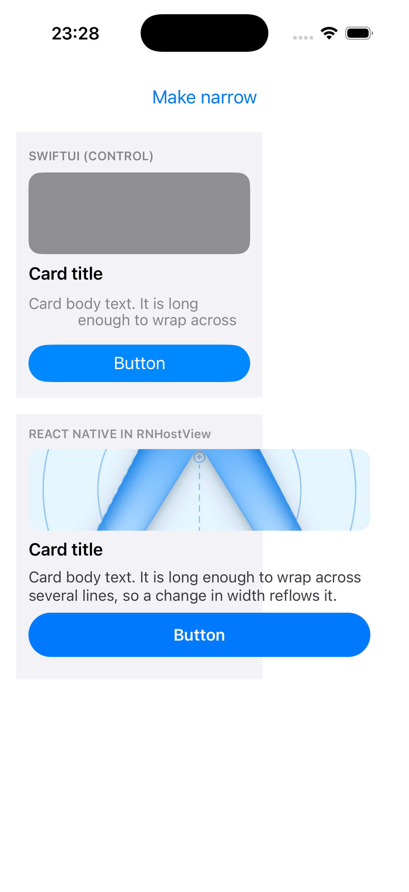
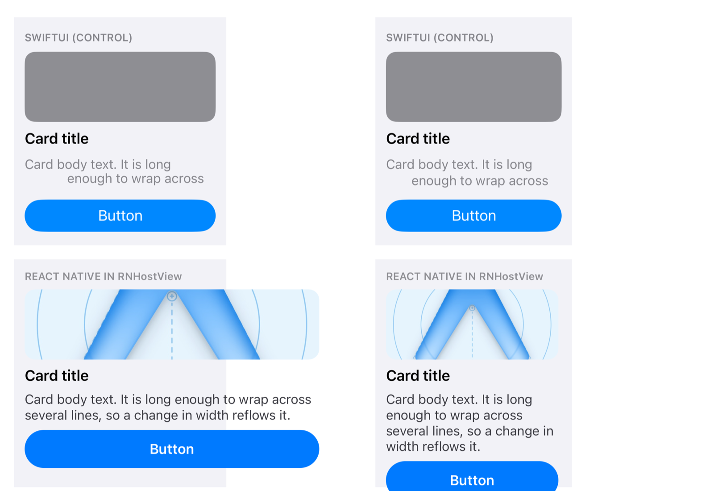
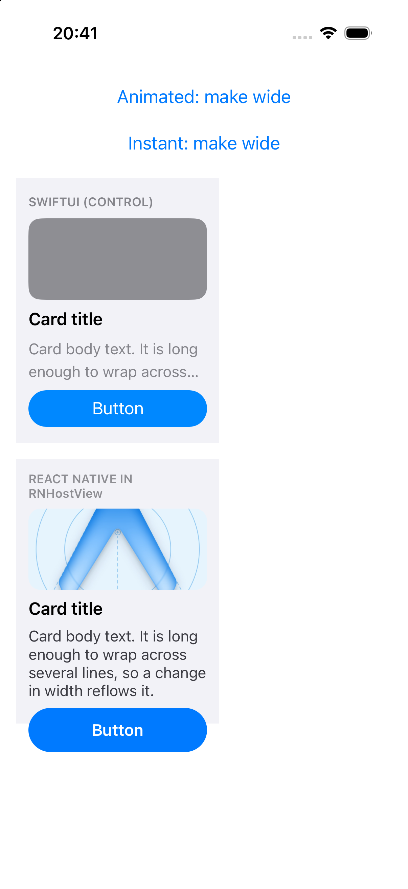
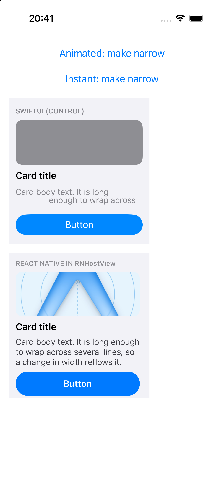
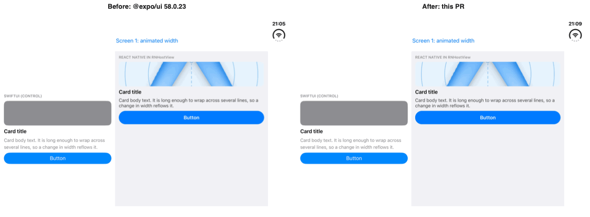
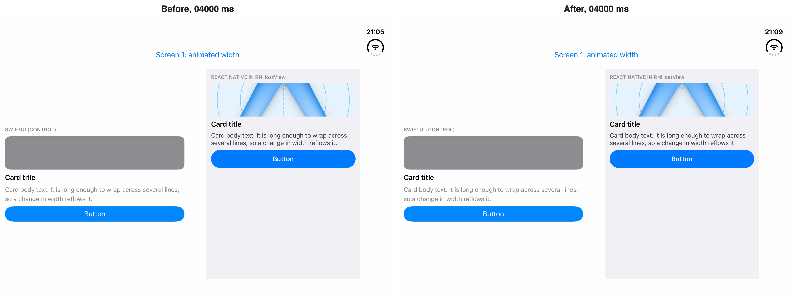

# RNHostView content snaps to its final size during an animated SwiftUI resize

Reproduction for https://github.com/expo/expo/issues/52396 on iOS, with frame-by-frame
measurements. Rebuilt from the reporter's
[rnhostview-resize-repro](https://github.com/swood09/rnhostview-resize-repro), Screen 1, as a
single-screen app without Expo Router.

Versions: Expo SDK 58, `@expo/ui` 58.0.23, React Native 0.88, iOS 26.5 simulator (iPhone 17),
Xcode 26.6.

## Run

```sh
npm install
npx expo run:ios      # development build, iOS simulator
```

## What the app does

Two copies of the same card, one built in SwiftUI (the control) and one built in React Native
inside `RNHostView`, sit in SwiftUI frames whose width animates between 200 and 360 points over
0.8 s (`frame({ width })` + `animation(Animation.easeInOut({ duration: 0.8 }), wide)`).

The **Make wide / Make narrow** button toggles the width. The app also toggles on its own at
3, 6, 9 and 12 s after launch so a screenshot loop can run without tapping, and it logs every
`onLayout` the hosted React Native view receives, with the time since the toggle.

## Expected

Both cards resize smoothly: the photo, the wrapping text and the button grow with the frame.

## Actual

The SwiftUI card interpolates. The React Native card lays out at its **final** size in the first
frame, while its frame is still at the starting width, so the content overflows the frame and
the frame then catches up.



## Measurements on 10/27/26, narrow → wide

`scripts/capture.sh` takes a screenshot burst across the first two automatic toggles and
`scripts/measure.py` reads the width of each card's grey background and blue button out of
every frame (pixels at 3x; 600 px = 200 pt, 1080 px = 360 pt).

| ms after launch | SwiftUI card | SwiftUI button | RN card | RN button |
| --- | --- | --- | --- | --- |
| 3524 | 600 | 512 | 600 | 506 |
| 3649 | 600 | 512 | 600 | **996** |
| 3783 | 634 | 546 | 634 | 996 |
| 3920 | 725 | 638 | 726 | 996 |
| 4050 | 840 | 752 | 840 | 996 |
| 4176 | 954 | 866 | 954 | 996 |
| 4306 | 1046 | 958 | 1046 | 996 |
| 4439 | 1079 | 992 | 1080 | 996 |

The SwiftUI button widens over six frames. The React Native button is at its final width in the
first frame, 396 px wider than the card it sits in.

Metro log for the same toggles: exactly one `onLayout` per toggle, already at the destination
width, and nothing during the 800 ms animation.

```
[52396] AUTO-TOGGLE 1 (t=3090)
[52396] onLayout width=360.0 height=260.0 +32ms after toggle (t=3122)
[52396] AUTO-TOGGLE 2 (t=6089)
[52396] onLayout width=200.0 height=260.0 +22ms after toggle (t=6111)
```

## Cause

`ReportSizeToYogaNodeModifier` in `packages/expo-ui/ios/RNHostView.swift` reports the hosted
view's size to Yoga from `onGeometryChange`. During an animated layout change that runs once,
with the destination size, so Yoga lays the hosted tree out at the final size before the
animation runs and nothing reports the sizes in between.

## With the fix

Same capture against `@expo/ui` built from source with
[the fix](https://github.com/expo/expo/compare/main...dileepapeiris:expo:fix/ui-rnhostview-animated-resize)
to `RNHostView.swift`, which reports every interpolated size through an `Animatable` modifier.

| ms after launch | SwiftUI button | RN button |
| --- | --- | --- |
| 3668 | 512 | 563 |
| 3794 | 522 | 513 |
| 3922 | 585 | 572 |
| 4053 | 701 | 694 |
| 4182 | 820 | 813 |
| 4366 | 965 | 968 |
| 4860 | 992 | 996 |

The React Native button now follows the SwiftUI one frame by frame. Metro logs 46 to 47
`onLayout` events per toggle, one per frame of the 0.8 s animation, from 200.7 up to 360.0.
Full output: `media/measure-with-fix.txt`, `media/metro-with-fix.txt`.

Before on the left, with the fix on the right, 0.27 s into the same animation:



## Cold launch and instant resize (added 10/28/26)

expo-bot's verification of the first version of the PR found two regressions: no size reached
Yoga on first mount, and none for a width change without animation. SwiftUI only sets
`animatableData` while an animation runs. The reporter now also reports from its body, with
`onAppear` for the first layout and `onChange(of: size)` for a change that is not animated.

The app now alternates an animated toggle (3 s, 9 s) with an instant one (6 s, 12 s), and
`scripts/capture-cases.sh` screenshots each case while `scripts/summarize.py` reads the Metro log
(`media/metro-cases-with-fix.txt`, summary in `media/summary-cases-with-fix.txt`):

| Phase | `onLayout` events | first width | last width | when |
| --- | --- | --- | --- | --- |
| cold launch, frame 200 | 1 | 200.0 | 200.0 | |
| animated 200 → 360 | 46 | 200.7 | 360.0 | 119 to 872 ms |
| instant 360 → 200 | 1 | 200.0 | 200.0 | 17 ms |
| animated 200 → 360 | 46 | 200.7 | 360.0 | 72 to 822 ms |
| instant 360 → 200 | 1 | 200.0 | 200.0 | 10 ms |

| Cold launch | Mid animation | After an instant toggle |
| --- | --- | --- |
|  |  |  |

## iPhone Duo, ArrangementView (added 10/28/26)

Screen 2 of the issue, run on the iPhone Duo simulator (iOS 27.1, Xcode 27.1). On the inner
display in landscape the app shows the two cards as the sides of an `ArrangementView`
(`arrangementViewStyle('split')`, like the issue's repro). The Duo cannot be folded from
`simctl`; `scripts/devicehub.sh` presses Device Hub's **Partially Open** and **Open** buttons,
and `scripts/capture-duo.sh` records a fold into book pose and back while `onLayout` logs the
hosted card's sizes.

Result: **the fix changes nothing here.** With and without it, each fold produces exactly one
`onLayout` on the hosted card, at the destination width (495 → 371.7 pt and back), and the
frame-by-frame button widths of the two recordings match
(`media/duo-frames-before.txt`, `media/duo-frames-after-with-fix.txt`,
`scripts/measure-frames.py`).

| Fold | Before: `onLayout` | After: `onLayout` |
| --- | --- | --- |
| flat → book pose | 1, at 371.7 pt | 1, at 371.7 pt |
| book pose → flat | 1, at 495.0 pt | 1, at 495.0 pt |

Why: Device Hub's pose buttons switch the hinge instantly. The simulator shows a blur
transition on the folded half for about 150 ms and the `ArrangementView` relayouts in one
step about a second later, in a transaction that is not animated. The `Animatable`
reporter only sees interpolated sizes during an animated transaction, so there is nothing
for it to report here. A real fold (or Device Hub's hinge-angle slider, which shows when
holding Option over the pose buttons and was not automated) drives the arrangement through
intermediate angles, which this capture does not cover.



Side by side as MP4: [media/duo-before-after.mp4](media/duo-before-after.mp4). Single captures:
[duo-before.mp4](media/duo-before.mp4), [duo-after-with-fix.mp4](media/duo-after-with-fix.mp4).
Both builds in book pose, 4 s into the recording:



```sh
open /Applications/Xcode.app/Contents/Applications/DeviceHub.app   # Device Hub on the Duo
scripts/devicehub.sh Open                                           # flat, then rotate to landscape
scripts/capture-duo.sh <duo udid> media/duo-before
swift scripts/compose.swift frames media/duo-before.mp4 frames-before 20
python3 scripts/measure-frames.py frames-before 1300 7000
```
